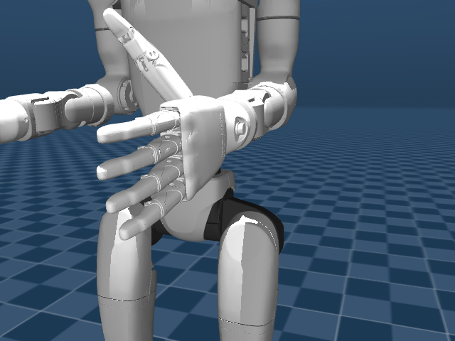
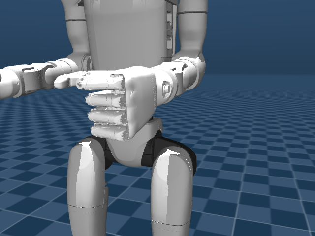
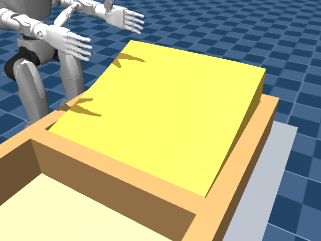
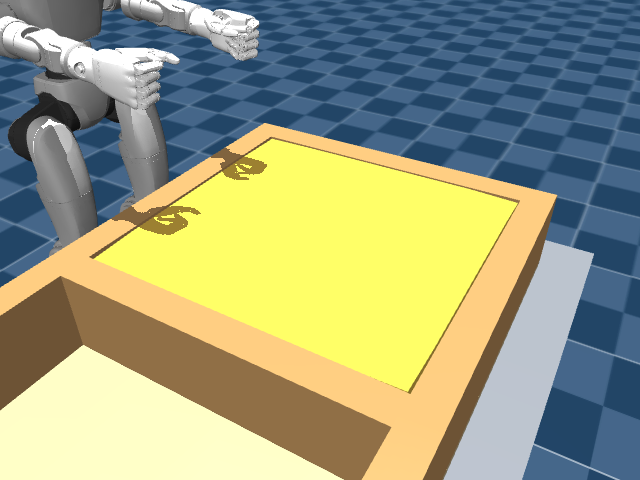
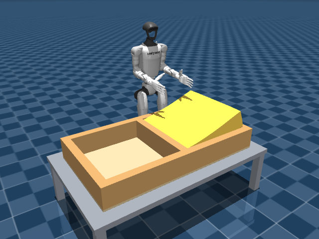

# Inspire RH56DFQ hands

The Unitree G1 in the lab has **Inspire Robots RH56DFQ** dexterous hands, not the standard Unitree hands. The label on the left hand says **RH56DFQ-2L**.

Each hand has 6 motors (thumb yaw, thumb pitch, index, middle, ring, pinky) and 12 joints: the outer finger joints follow the motors.

## MuJoCo

`scene.xml` loads the G1 with both hands. The pelvis is fixed at standing height, so you can work on arms and hands without a balance controller. There are 41 position motors: 29 for the body and 6 per hand.

```bash
pip install -U mujoco
python -m mujoco.viewer --mjcf=scene.xml   # move each motor with the sliders under "Control"
python grasp_demo.py                       # both hands close and open in a loop (macOS: mjpython grasp_demo.py)
```

Tested with MuJoCo 3.2.7 and 4.0.1. The motor gains are estimates for simulation, not the values of the real robot. When a hand closes all the way, the thumb meets the index finger, like on the real hand.

| Open | Closed |
|---|---|
|  |  |


## Wall mock-up and insulation

`scene_wall.xml` adds an assembly table with a timber-frame wall lying flat (2 open bays facing up, a board underneath) and one soft insulation batt on bay 1, straight in front of the robot.

```bash
pip install -U mujoco                         # the soft batt needs MuJoCo 4
python -m mujoco.viewer --mjcf=scene_wall.xml
python insulation_demo.py                     # the batt sticks halfway, gets pressed in, fill is printed every second
```

- The batt is 1 cm wider than the bay, like on site, so it clamps. On its own it gets stuck halfway; a press of about 80 N pushes it in, and it stays in when you let go.
- `fill_report()` in `insulation_demo.py` measures a bay: share of the batt inside, share still sticking out, gap at the bottom. Use it to score your own runs.
- The demo presses with an outside force, not with the robot. Moving the hands to do it is your job.

**The size of the real mock-up was not known yet.** The defaults are a typical German timber-frame wall: studs 60 × 160 mm on a 625 mm grid (bays 565 mm wide), bays 600 mm long, table top at 0.40 m. All numbers, and the stiffness and weight of the insulation, are at the top of `make_wall.py`. Change them and run `python make_wall.py` to rebuild `wall.xml`. With the pelvis fixed, the hands reach only the near part of the bay; move the robot (`pos` of the `pelvis` body in `g1_inspire_dfq.xml`) or the table if you need more.

Tested headless with MuJoCo 4.0.1: stable, about real-time on 2 CPU cores.

| Batt stuck halfway | Pressed in |
|---|---|
|  |  |



## Files

| File | What |
|---|---|
| [scene.xml](scene.xml) | MuJoCo scene: floor, light and the robot |
| [scene_wall.xml](scene_wall.xml) | Same, plus table, timber-frame wall and insulation batt |
| [wall.xml](wall.xml) | Table, wall and batt (made by `make_wall.py`) |
| [make_wall.py](make_wall.py) | Sizes of the mock-up and the insulation; writes `wall.xml` |
| [insulation_demo.py](insulation_demo.py) | Demo + `fill_report()` to measure how well a bay is filled |
| [g1_inspire_dfq.xml](g1_inspire_dfq.xml) | MuJoCo model of the G1 with both hands |
| [grasp_demo.py](grasp_demo.py) | Small demo: opens the viewer and moves the fingers |
| [build_mjcf.py](build_mjcf.py) | Makes `g1_inspire_dfq.xml` again from the URDF, if you change it |
| [g1_29dof_rev_1_0_with_inspire_hand_DFQ.urdf](g1_29dof_rev_1_0_with_inspire_hand_DFQ.urdf) | URDF: whole G1 (29 DoF) with both hands |
| [DFQ_left_hand.urdf](DFQ_left_hand.urdf) | URDF: left hand alone |
| [DFQ_right_hand.urdf](DFQ_right_hand.urdf) | URDF: right hand alone |
| [config.yaml](config.yaml) | Links and joints that are removed from the G1 when these hands go on |
| [meshes](meshes) | STL meshes used by all files above |

Mesh paths are relative (`meshes/...`), so keep the folder together.

## Source

URDFs and meshes from Unitree's [unitree_ros](https://github.com/unitreerobotics/unitree_ros/tree/master/robots/g1_description), copied on 27 Nov 2026. BSD 3-Clause, see [LICENSE](LICENSE). The MuJoCo files are made from them with `build_mjcf.py`.
