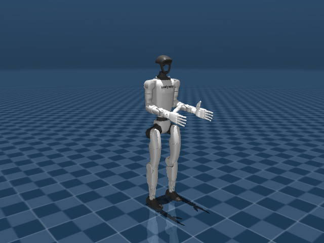

# Inspire RH56DFQ hands

The Unitree G1 in the lab has **Inspire Robots RH56DFQ** dexterous hands, not the standard Unitree hands. The label on the left hand says **RH56DFQ-2L**.

Each hand has 6 motors (thumb yaw, thumb pitch, index, middle, ring, pinky) and 12 joints: the outer finger joints follow the motors.

## MuJoCo

`scene.xml` loads the G1 with both hands. The pelvis is fixed at standing height, so you can work on arms and hands without a balance controller. There are 41 position motors: 29 for the body and 6 per hand.

```bash
pip install -U mujoco
python -m mujoco.viewer --mjcf=scene.xml   # move each motor with the sliders under "Control"
python grasp_demo.py                       # both hands close and open in a loop (macOS: mjpython grasp_demo.py)
```

Tested with MuJoCo 3.2.7 and 4.0.1. The motor gains are estimates for simulation, not the values of the real robot. When a hand closes all the way, the thumb meets the index finger, like on the real hand.

| Open | Closed |
|---|---|
|  |  |



## Files

| File | What |
|---|---|
| [scene.xml](scene.xml) | MuJoCo scene: floor, light and the robot |
| [g1_inspire_dfq.xml](g1_inspire_dfq.xml) | MuJoCo model of the G1 with both hands |
| [grasp_demo.py](grasp_demo.py) | Small demo: opens the viewer and moves the fingers |
| [build_mjcf.py](build_mjcf.py) | Makes `g1_inspire_dfq.xml` again from the URDF, if you change it |
| [g1_29dof_rev_1_0_with_inspire_hand_DFQ.urdf](g1_29dof_rev_1_0_with_inspire_hand_DFQ.urdf) | URDF: whole G1 (29 DoF) with both hands |
| [DFQ_left_hand.urdf](DFQ_left_hand.urdf) | URDF: left hand alone |
| [DFQ_right_hand.urdf](DFQ_right_hand.urdf) | URDF: right hand alone |
| [config.yaml](config.yaml) | Links and joints that are removed from the G1 when these hands go on |
| [meshes](meshes) | STL meshes used by all files above |

Mesh paths are relative (`meshes/...`), so keep the folder together.

## Source

URDFs and meshes from Unitree's [unitree_ros](https://github.com/unitreerobotics/unitree_ros/tree/master/robots/g1_description), copied on 27 Nov 2026. BSD 3-Clause, see [LICENSE](LICENSE). The MuJoCo files are made from them with `build_mjcf.py`.
