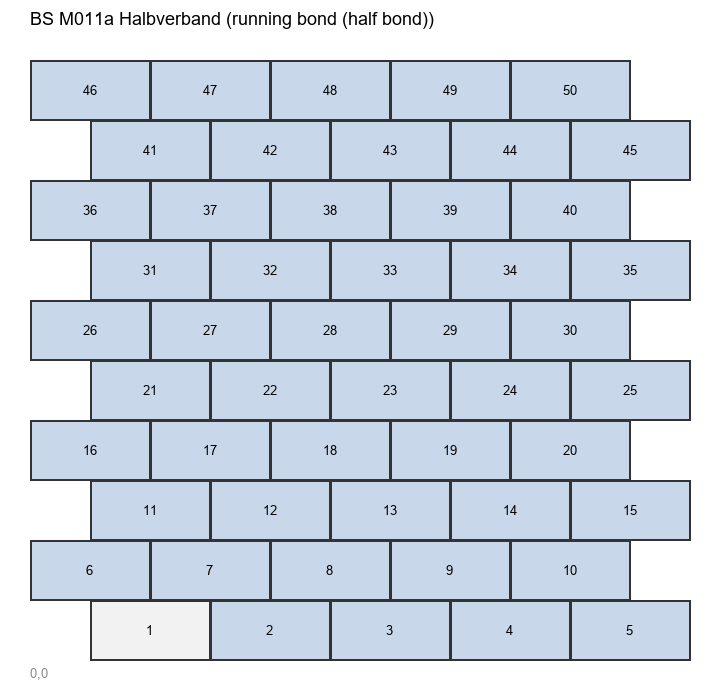
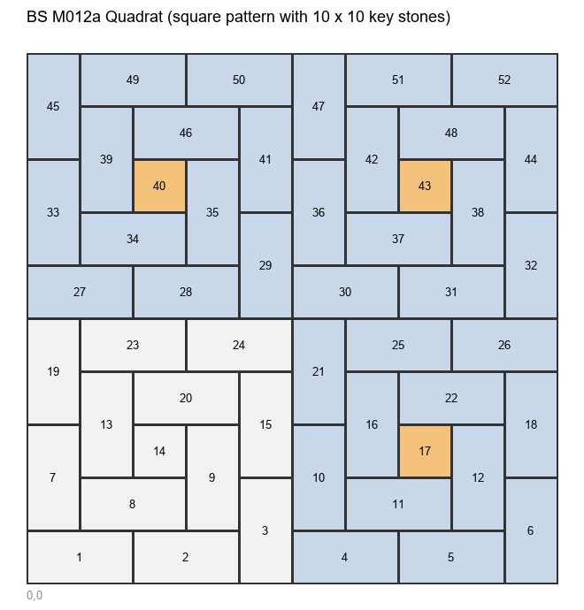
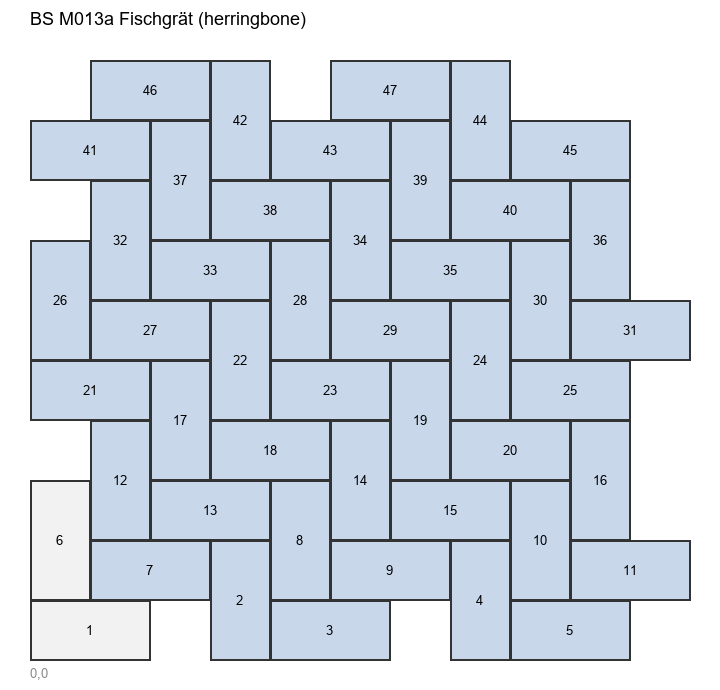
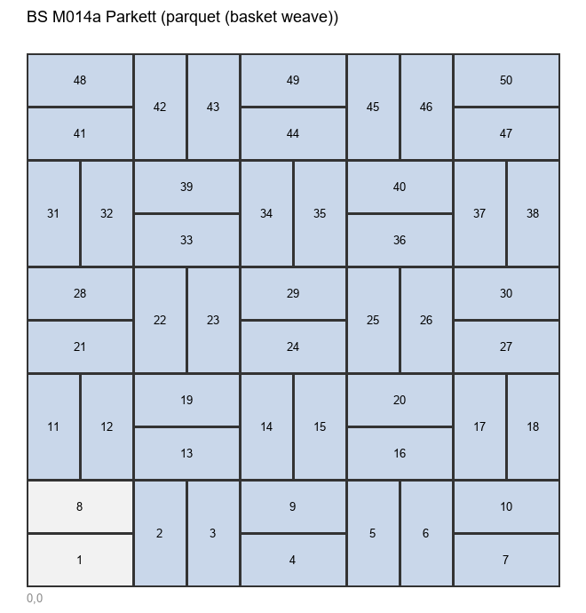

# Laying patterns for 20 × 10 cm paving stones

Four standard patterns for rectangular paving stones, taken from KANN Bausysteme's sheet
[Rechteckpflaster 20 × 10 cm / 10 × 10 cm (PDF)](https://kann-bausysteme.de/fileadmin/user_upload/kbs_verlegemuster_rechteckpflaster_2020.pdf).
The PDF belongs to KANN, so it is linked here, not copied. Everything in this folder is made from it with `extract_patterns.py`.

The stones in the PDF are exact vector shapes, so every stone's position is read from the sheet, not guessed.

| Pattern | KANN code | Stones per m² | Sample on the sheet | Repeats every (cm) | Data | Picture |
|---|---|---|---|---|---|---|
| Halbverband (running bond) | BS M011a | 50 × 20/10 | 110 × 100 cm, 50 stones | (10, 10) and (−10, 10) | [running_bond.csv](running_bond.csv) | [png](running_bond.png) |
| Quadrat (square, with 10 × 10 key stones) | BS M012a | 48 × 20/10 + 4 × 10/10 | 100 × 100 cm, 52 stones | (50, 0) and (0, 50) | [square.csv](square.csv) | [png](square.png) |
| Fischgrät (herringbone) | BS M013a | 50 × 20/10 | 110 × 100 cm, 47 stones | (10, 10) and (−20, 20) | [herringbone.csv](herringbone.csv) | [png](herringbone.png) |
| Parkett (parquet / basket weave) | BS M014a | 50 × 20/10 | 100 × 100 cm, 50 stones | (20, 20) and (−20, 20) | [parquet.csv](parquet.csv) | [png](parquet.png) |

All four are also in [patterns.json](patterns.json).

## How the data works

One row per stone:

| Column | Meaning |
|---|---|
| `id` | Number of the stone, bottom row first, left to right. Only a name, **not** a laying order. |
| `x`, `y` | Centre of the stone in cm. Origin = bottom-left corner of the sample, x to the right, y up. |
| `size` | `20x10` or `10x10` (cm) |
| `rotation` | `0` = long side along x, `90` = long side along y |
| `white_on_sheet` | The stone is drawn white on the KANN sheet (the sheet does not say why) |

**Bigger area:** the pattern repeats. Copy every stone by `i × v1 + j × v2` with the two "repeats every" vectors (`repeat_cm` in the JSON) and keep the stones that fall inside your area. Example: the herringbone repeats every 10 cm right + 10 cm up, and every 20 cm left + 20 cm up.

**Joints:** the sheet draws the stones edge to edge. Real paving has a joint of a few millimetres between stones (often 3–5 mm). Add it to your positions if your robot places stones that precisely.

## Pictures

Our own drawings from the data, with the stone ids (orange = 10 × 10 stone, grey = white on the KANN sheet):

| | |
|---|---|
|  |  |
|  |  |

## Make it again

```bash
pip install pymupdf pillow
# download the PDF from the link above into this folder, then:
python extract_patterns.py kbs_verlegemuster_rechteckpflaster_2020.pdf
```
